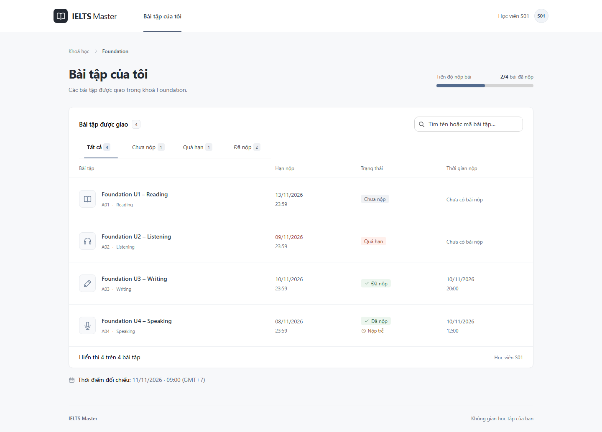

# TestProject — Bài tập của tôi

Ứng dụng full-stack hiển thị bài tập của học viên **S01** theo đề bài IELTS Master. Học viên có thể xem hạn nộp, trạng thái, thời gian đã nộp và tìm kiếm hoặc lọc bài tập. Dữ liệu và danh tính học viên được giả lập tại backend.

## Giao diện



Giao diện sử dụng Astryx với theme sáng, hỗ trợ desktop và mobile, có trạng thái tải dữ liệu, lỗi kết nối, thử lại và danh sách rỗng.

## Công nghệ và cấu trúc

| Thành phần | Công nghệ                       |
| ---------- | ------------------------------- |
| Frontend   | React, TypeScript, Vite, Astryx |
| Backend    | Node.js, Express, TypeScript    |
| Kiểm thử   | Node.js Test Runner, Playwright |

Hai workspace dùng chung một lockfile và lệnh chạy tại thư mục gốc.

```text
frontend/src/features/assignments/   Giao diện, API client và quản lý trạng thái tải
backend/src/modules/assignments/    Route, service, dữ liệu mẫu và logic trạng thái
backend/src/auth/mock-session.ts    Danh tính học viên giả lập tại server
backend/src/config/mock-clock.ts    Thời điểm đối chiếu cố định
backend/tests/                     Unit tests và HTTP integration tests
e2e/                               Kiểm thử trình duyệt
docs/images/                       Ảnh giao diện dùng trong README
```

Luồng dữ liệu: **Frontend → API → danh tính tại server → lọc bài tập → tính trạng thái → trả kết quả**. Quy tắc nghiệp vụ nằm ở backend; frontend trình bày kết quả và xử lý tìm kiếm, bộ lọc.

## Cài đặt và chạy

Yêu cầu **Node.js từ 22.12.0** và npm. Sau khi clone repository, chạy tại thư mục gốc:

```sh
npm ci
npm run dev
```

- Giao diện: http://localhost:5173
- API bài tập: http://127.0.0.1:3001/api/me/assignments
- Health check: http://127.0.0.1:3001/api/health

Ứng dụng chạy với dữ liệu mẫu có sẵn, không cần `.env`, database hoặc tài khoản nội bộ. Vite proxy chuyển request `/api` từ frontend sang backend. Trên PowerShell, dùng `npm.cmd` và `npx.cmd` nếu execution policy chặn script `.ps1`.

## Quy tắc trạng thái

Thời điểm đối chiếu cố định là **11/11/2026, 09:00 GMT+7** (`2026-11-11T09:00:00+07:00`). Ứng dụng sử dụng thời điểm này để tính trạng thái, không phụ thuộc ngày giờ hiện tại. Ngày giờ trên giao diện được định dạng theo `Asia/Ho_Chi_Minh`.

| Bài tập     | Kết quả mong đợi                                 |
| ----------- | ------------------------------------------------ |
| A01         | Chưa nộp                                         |
| A02         | Quá hạn                                          |
| A03         | Đã nộp                                           |
| A04         | Đã nộp và Nộp trễ                                |
| B01 của S02 | Không xuất hiện trong API hoặc giao diện của S01 |

Kiểm tra đã nộp trước khi xét quá hạn. “Nộp trễ” là thông tin bổ sung khi thời gian nộp lớn hơn hạn nộp. Quy ước biên: đúng bằng hạn vẫn được coi là đúng hạn.

## Cách tránh lộ dữ liệu S02

API `GET /api/me/assignments` lấy danh tính S01 từ [mock-session.ts](backend/src/auth/mock-session.ts). Giá trị `studentId` do client gửi qua URL, query, header hoặc body không được dùng làm danh tính.

[Service](backend/src/modules/assignments/assignments.service.ts) lọc bài tập theo học viên **trước khi tạo response**, chỉ trả các trường cần hiển thị. Dữ liệu mẫu S02 nằm trong backend, không được import vào frontend hoặc đặt trong `public/`. Response API có `Cache-Control: private, no-store`.

Ví dụ, gọi `/api/me/assignments?studentId=S02` vẫn chỉ nhận A01–A04 của S01. Đây là cơ chế giả lập theo đề; khi dùng thực tế cần thay bằng session đã được xác thực.

## Kiểm tra

Kiểm tra định dạng, TypeScript, unit/HTTP tests và build cả hai workspace:

```sh
npm run check
```

Kiểm thử trình duyệt trên frontend đã build:

```sh
npx playwright install chromium
npm run test:e2e
```

E2E tự mở backend và frontend preview tại cổng **3002/5174**; hai cổng này cần đang trống. Phạm vi kiểm thử gồm bốn trạng thái, lọc đúng S01, giả mạo danh tính S02, biên thời gian, tìm kiếm, thao tác bàn phím, loading/error/retry/empty và bố cục tới 320px. Trình duyệt được kiểm tra ở múi giờ UTC và America/Los_Angeles để xác minh giao diện vẫn hiển thị giờ Việt Nam.

**Kết quả kiểm tra ngày 12/11/2026, Node.js 24.13.0:** cài sạch bằng `npm ci` thành công; format, typecheck và build thành công; **16/16 backend tests** và **18/18 E2E tests** pass, không bỏ qua hoặc retry.

## Phần chưa làm

- Chưa có đăng nhập/session thật, database và chức năng upload hoặc nộp bài.
- Chưa deploy; ứng dụng được chạy và kiểm tra tại local theo phạm vi đề.
- E2E sử dụng Chromium và giả lập mobile; chưa kiểm tra Firefox, Safari hoặc thiết bị vật lý.

Toàn bộ dữ liệu là dữ liệu giả lập theo đề, không sử dụng dữ liệu thật hoặc secrets.
